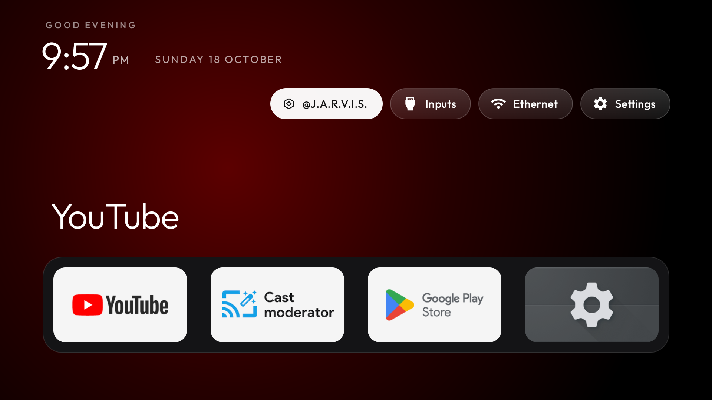

# Android TV Harness

A specialized harness for **Android TV and Google TV**, built from [tv-vibehack](https://github.com/Gathin23/tv-vibehack) and the structure of Harshith's [Vertical Harness](https://github.com/harshith-vaddiparthy/Vertical-Harness) template.

The TV keeps its native home screen, streaming dock, app grid, inputs and settings. One additional **@J.A.R.V.I.S.** button opens an existing agent workspace when connected later. For this version, it says “J.A.R.V.I.S. isn't connected yet.” There is no separate dashboard, on-TV agent, or Hermes configuration.

The executable harness gives an agent a narrow set of TV operations: inventory, change planning, launcher installation and Home selection, package enable/disable, screenshots, verified execution and restoration. It supports Android TV devices that advertise TV features and allow ADB access and third-party Home selection. Vendor restrictions can still prevent launcher replacement. In the Android TV 14 emulator used here, the stock launcher retains higher Home priority even after the HOME role changes. The harness detects this, reports failure and restores state; it does not disable stock Home to force a switch. Samsung Tizen, LG webOS, Fire TV and generic non-Android TVs are outside the supported scope.



*Emulator screenshot. This is not a capture of the owner's physical TV.*

## Build

The Python harness uses the standard library, Python 3.10+ and native Android platform-tools. Native ADB supports Android 14 wireless pairing as well as older port-5555 devices.

On macOS, install the build dependencies:

```bash
HOMEBREW_NO_AUTO_UPDATE=1 brew install openjdk@17 android-commandlinetools android-platform-tools
export JAVA_HOME=/opt/homebrew/opt/openjdk@17/libexec/openjdk.jdk/Contents/Home
export PATH="$JAVA_HOME/bin:$PATH"
sdkmanager --licenses
sdkmanager 'platforms;android-34' 'build-tools;34.0.0' 'platform-tools'
launcher/build-harness.sh
python3 -m unittest discover -s tests -v
```

The build script configures resources from [config/launcher.json](config/launcher.json), builds the debug APK, and runs Android JVM tests and lint. It does **not** connect to or change a TV. APK: `launcher/app/build/outputs/apk/debug/app-debug.apk`.

On other hosts, set `JAVA_HOME` to JDK 17 and `ANDROID_HOME` to your Android SDK before building. Linux/macOS are supported for the runtime's file locking; Windows requires WSL.

## Operate one TV

Read [operations/runbook.md](operations/runbook.md) for pairing and recovery. Always pass the exact ADB serial shown by `adb devices`; nothing scans the network or selects a target automatically.

```bash
python3 -m harness doctor
python3 -m harness --serial TV_ADDRESS:ADB_PORT inventory
```

For first-time launcher installation, create `install-request.json` containing:

```json
{
  "apk": "/absolute/path/to/Android TV Harness/launcher/app/build/outputs/apk/debug/app-debug.apk",
  "set_home": true
}
```

Then plan, review and execute the exact saved plan:

```bash
python3 -m harness --serial TV_ADDRESS:ADB_PORT plan install-request.json
python3 -m harness --serial TV_ADDRESS:ADB_PORT apply PLAN_ID
python3 -m harness run PLAN_ID
python3 -m harness --serial TV_ADDRESS:ADB_PORT screenshot
python3 -m harness --serial TV_ADDRESS:ADB_PORT restore PLAN_ID
```

Planning reads the TV and saves its identity, package lists, Home component and exact touched package states. `apply` is the explicit write operation. The runtime checks plan integrity, a 15-minute expiry, device identity, state drift and APK checksum before writing. It checkpoints each attempted action before execution, verifies its result, and attempts restoration after failure. A failed action remains a failed run even when recovery succeeds.

Stock Home remains installed and enabled. Core OS, settings, input methods, Cast, voice, updates, tuner packages and recognized launchers are protected from disable operations. Manufacturer examples in `examples/` are reference data; they are not automatically applied. Package knowledge is conservative, not a complete dependency graph: review each proposed package against that TV's services.

## The @J.A.R.V.I.S. button

[config/launcher.json](config/launcher.json) owns the label and future destination. The label can be `@J.A.R.V.I.S.` or `Hermes`. Leave both `url` and `package` empty for the current deferred connection. Later, set **one** to an existing workspace address or installed Android TV app package, then rebuild the APK.

The launcher hands web addresses to an installed browser and app targets to Android's TV launch intent. It keeps authentication in that existing app/browser. A missing app/browser produces a short availability message. It does not create Codex sessions, copy email, or provide Hermes capabilities by itself; those remain the responsibility of the future workspace connection.

In-place APK updates are deliberately blocked by the harness until an APK backup/update workflow exists. For development, restore the initial installation before deploying a newly built version.

## Future agent connection

The JSON CLI is usable by any agent with shell access. An optional stdio MCP adapter exposes the same operations:

```bash
python3 -m harness mcp
```

See [operations/agent-contract.md](operations/agent-contract.md). Nothing registers this server with Hermes or modifies model/provider settings. The caller's runtime is responsible for requester authentication and carrying user authorization; local plan IDs prevent unintended replay and bind a specific change, but are not an identity/authentication mechanism.

## Evidence and source

Private run evidence lives in `.state/`, excluded from Git and created with restricted permissions. See [domain/output-contract.md](domain/output-contract.md) and [evals/rubric.md](evals/rubric.md) for completion rules. [operations/verification.md](operations/verification.md) records what was actually checked for this build.

Original upstream source and licenses remain in place. Legacy upstream `tools/disable.*`, `tools/restore.*`, and `launcher/build-and-install.*` are replaced with retirement notices so the unsafe bulk flows cannot bypass the new runtime. The low-level original Python utilities remain reference/developer tools outside the harness contract. [The original README](operations/upstream-README.md) is retained for provenance; its automation commands describe the upstream version.

MIT: [LICENSE](LICENSE). Outfit: [launcher/FONT-LICENSE-OFL.txt](launcher/FONT-LICENSE-OFL.txt).
